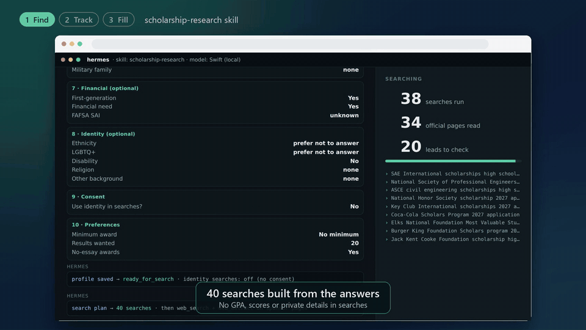

# Hermes Scholarship Toolkit

[](https://github.com/RavvaOfLight/hermes-scholarship-toolkit/actions/workflows/tests.yml)
[](LICENSE)

**Find scholarships. Track them. Fill the forms.**

[](https://github.com/RavvaOfLight/hermes-scholarship-toolkit/releases/tag/v1.2.0)

▶ **[Watch the one-minute video](https://github.com/RavvaOfLight/hermes-scholarship-toolkit/releases/tag/v1.2.0)** (shown with a fictional student; no real personal data).

Tools for finding, tracking, and applying for U.S. scholarships with
[Hermes Agent](https://github.com/NousResearch/hermes-agent):

| Part | What it does |
| --- | --- |
| [`skills/scholarship-research`](skills/scholarship-research/SKILL.md) | A Hermes skill that finds current scholarships for one student, proves each one on the sponsor's own website, and checks eligibility, deadlines, and award cycles with deterministic scripts before anything reaches the report. |
| [`apps/board`](apps/board/README.md) | A phone-friendly board for the results: statuses, notes, application checklists, a calendar, `.ics` and CSV downloads, and a weekly watch of pages that aren't open yet. |
| [`apps/autofill`](apps/autofill/README.md) + [`skills/scholarship-form-fill`](skills/scholarship-form-fill/SKILL.md) | A browser side panel (Edge or Chrome) that fills the repetitive boxes on applications (parents, counselor, GPA, test scores, financial aid, classes, address), including custom and range dropdowns, from answers saved on your computer. It reads your classes from a pasted transcript, and a portable copy runs on Chromebooks with no setup. **It never submits anything.** The Hermes skill only saves answers for it. |

Everything runs on your own computer. To use the board from your phone, see
[Remote access with Tailscale](docs/remote-access.md).

## Quick start

```bash
git clone https://github.com/RavvaOfLight/hermes-scholarship-toolkit
cd hermes-scholarship-toolkit

# 1. the research skill (and, if you'll use autofill, the form-fill skill)
hermes skills install RavvaOfLight/hermes-scholarship-toolkit/skills/scholarship-research --category research
hermes skills install RavvaOfLight/hermes-scholarship-toolkit/skills/scholarship-form-fill --category productivity

# 2. the board (each research run then adds its results to it automatically)
apps/board/install.sh                      # http://127.0.0.1:8765
python3 apps/board/set_password.py YOUR_NAME

# 3. the autofill companion
apps/autofill/install.sh                   # then: edge://extensions -> Load unpacked
```

Start a new Hermes session after installing skills; skills load when a session starts. You
can also add the repository as a tap (`hermes skills tap add RavvaOfLight/hermes-scholarship-toolkit`)
so `hermes skills search scholarship` finds both skills, or copy the skill folders into
`~/.hermes/skills/<category>/` by hand.

## Scholarship research skill

Scholarship databases are good at listing awards and bad at keeping them current. This skill
treats them as leads only. A scholarship appears as "verified" only after the agent finds it on
an official sponsor page or an authorized administrator's page, with evidence for the amount,
deadline, eligibility, and application steps, checked within the last seven days.

- **Guided, privacy-first onboarding.** A ten-part questionnaire is shown as `clarify` forms.
  Every optional question can be skipped, nothing is guessed, and identity details are used in
  searches only after a separate consent question.
- **A search plan built for the student.** Target colleges first, then local and school sources,
  the official state aid agency, and then organizations the profile points to (professional
  societies, clubs, employers, military families, national programs). The plan never contains
  GPA, test scores, SAI, or disability details.
- **Bounded research.** Searches run in small batches inside Hermes's `execute_code` sandbox.
  Official domains are read before databases, and each page comes back as a short excerpt that
  always keeps its amount, deadline, eligibility, fee and repayment, and time-zone passages.
  Every page and excerpt is saved in the run workspace. Lines in a page that are addressed to
  an AI are dropped.
- **A page audit before the report.** Each stored record is re-checked against its own pages
  with no model in the loop: the page must name the scholarship, show the deadline (with its
  year) and the award amount (not a program total), and fee, repayment, or drawing wording is
  flagged.
- **Deterministic verification.** Every record is checked for source authority, the current
  cycle, deadlines in the sponsor's time zone, fees, loans, sweepstakes, and structured
  eligibility rules, then sorted into verified, needs confirmation, ineligible, expired,
  unverified, and rejected.
- **A registry of 109 official sources**, including the student-aid agency for all 50 states
  and DC.
- **Useful output.** A Markdown report, an `.ics` calendar with a reminder a week before each
  deadline, a CSV, and structured results the board imports.
- **Several students, safely.** Each student has their own saved profile. Deleting one shows its
  summary first and moves it to a private trash.
- **Measurable accuracy.** Score any run against a hand-checked gold list.

Ask in a normal Hermes chat, for example "Find scholarships I qualify for. I'm a high school
senior in Ohio planning to study nursing." The skill needs an interactive session. One-shot
(`hermes chat -q`) runs can't collect the student's answers, so the skill stops instead of
guessing.

| Source | Proof required |
| --- | --- |
| Official sponsor page | A same-domain page showing the sponsor runs the program, or a domain registered for that sponsor in `trusted-sources.json` |
| Authorized administrator | A page on the sponsor's own, separate domain naming the administrator |
| Discovery database | Never enough; such records are reported only as unverified leads |

## Requirements

- Hermes Agent 0.21 or later with the `web` and `code_execution` toolsets and a working web
  search backend (`hermes tools`). `clarify` is recommended.
- Python 3.10 or later. Everything uses only the standard library, except PDF import on the
  board (`pypdf`).
- Linux, macOS, or Windows with WSL for the board and the autofill service (they use systemd
  user services when they're available). The autofill extension needs Edge or Chrome 116 or later.
- Optional: [Tailscale](https://tailscale.com) to open the board from your phone.

## Privacy

- **Research skill.** It never collects names, addresses, birth dates, SSNs, tax or bank data,
  or FAFSA/FSA ID credentials. Answers live in an owner-only run workspace, and a reusable
  profile is saved to `~/.hermes/` only when you ask. Search phrases never include GPA, test
  scores, SAI, or disability status. It never writes to the agent's long-term memory.
- **Board.** Data is kept in `~/.hermes/scholarship-board/` (owner-only), with no profile
  details beyond the state and the intended major. It listens on `127.0.0.1` only, accepts
  changes only from its own page, and supports a password login.
- **Autofill.** Answers stay in `~/.hermes/scholarship-fill/data/` (owner-only). The service
  listens on `127.0.0.1` only, needs a private key, and refuses requests from websites. SSNs,
  passwords, FSA IDs, and bank details are refused outright. The fill log records which box got
  which item, never the value.
- **Your model provider** sees everything you type into Hermes, as in any Hermes conversation.

See [SECURITY.md](SECURITY.md) for the threat model.

## Repository layout

```text
skills/scholarship-research/   the research skill (SKILL.md, scripts/, references/)
skills/scholarship-form-fill/  the skill that saves autofill answers
apps/board/                    scholarship board: server.py, app.html, import.py, watch.py
apps/autofill/                 autofill companion: extension/, local service, CLI, installer
docs/remote-access.md          phone and other-computer access with Tailscale
docs/hermes-integration.md     which Hermes features the research skill relies on, and why
tests/                         research skill tests (offline)
```

## Development

```bash
python -m pip install pytest pyyaml
python -m pytest                                   # every Python suite, offline
node --test "apps/autofill/tests/*.test.mjs"       # autofill label matching
node apps/autofill/tests/e2e.mjs                   # headless Chromium + extension (CHROME=...)
node apps/board/tests/browser_smoke.mjs            # headless Chromium + board
```

With a hermes-agent checkout at `~/.hermes/hermes-agent` (or `HERMES_AGENT_DIR`), the suite
also runs Hermes's own skill scanner and linter against both skills. See
[CONTRIBUTING.md](CONTRIBUTING.md).

## Limitations

- United States only, English-language pages.
- Research coverage depends on your search backend. Pages that need JavaScript may need the
  `browser` toolset.
- The source registry was last reviewed on 2026-10-22. Agencies rename and move sites, so
  domains need periodic review.
- Autofill: forms embedded from another site have to be opened in their own tab, PDF forms
  aren't supported, and transcripts that are scans (pictures) can't be read.
- This is research assistance, not financial advice. It doesn't guarantee eligibility or an
  award. Always confirm details on the official page before applying.

## License

Created by **Preston Campbell**.

Free for non-commercial use under the [PolyForm Noncommercial License 1.0.0](LICENSE). Students,
families, schools, counselors, libraries, charities and researchers can use, share and change it.
Selling it, or using it in a paid product or service, isn't allowed without the author's
permission. If you share a copy or build something new from it, keep the license and its
`Required Notice: Copyright (c) 2026 Preston Campbell` line.

This is source-available software, not "open source" in the OSI sense, because commercial use
is excluded.

## Acknowledgments

This project was built with the help of [Claude Code](https://claude.com/claude-code), an AI
coding assistant. All of it was reviewed, tested, and directed by the author.
